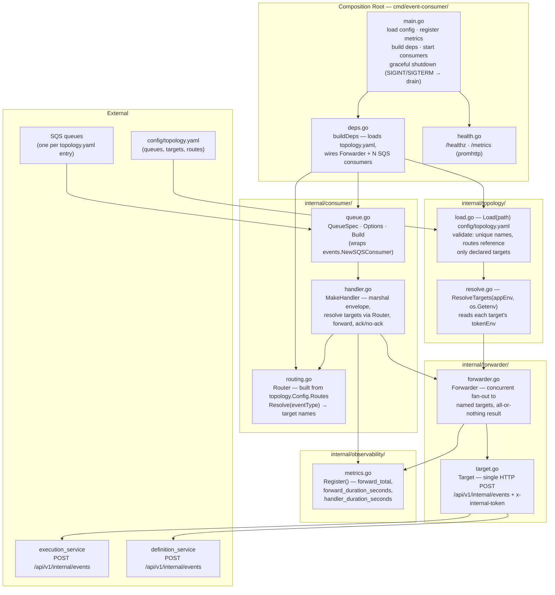
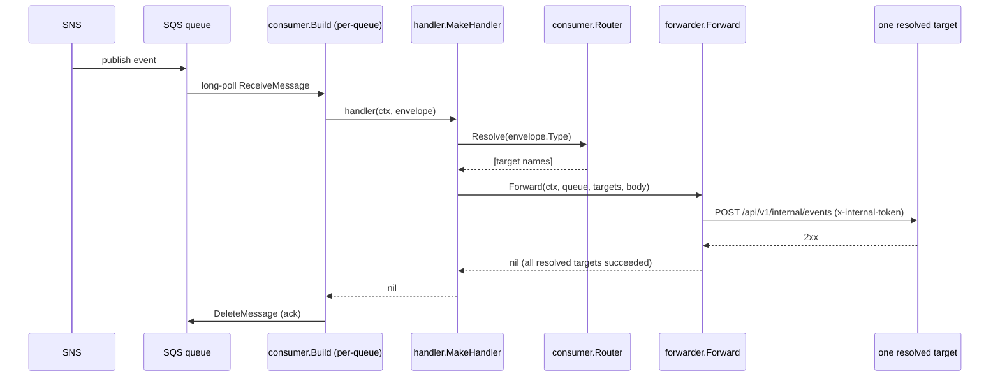
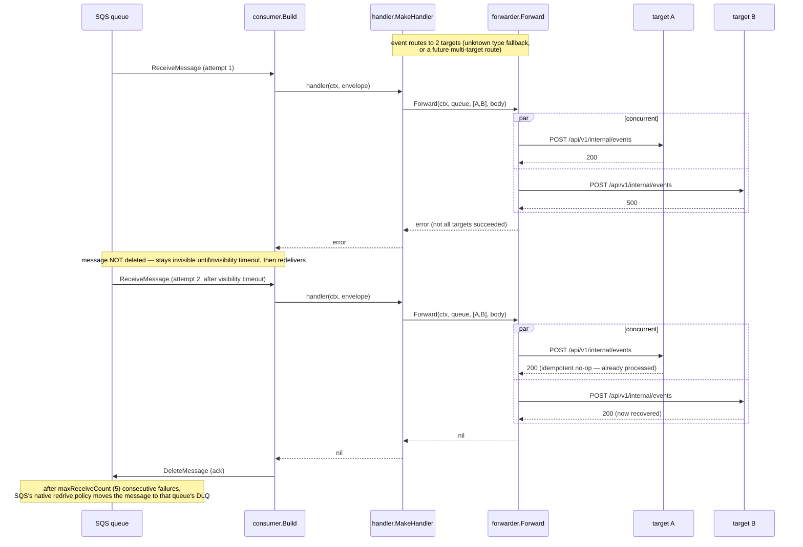

# Architecture

This document describes the internal structure and runtime data flows of
`workflow-events-consumer`.

`workflow-events-consumer` is a **private Go service**
(`github.com/BCBP-SOLUTIONS-FZC-LLC/workflow-events-consumer`, Go 1.26.5+). It
is a stateless bridge: it owns no database, no business logic, and no event
catalogue interpretation beyond routing. It exists so that
`execution_service` and `definition_service` never have to run their own SQS
consumers.

---

## Component model

> Source: [`docs/architecture/mermaid/component-diagram.mmd`](docs/architecture/mermaid/component-diagram.mmd)

**Rule:** `internal/forwarder` is transport-only — it fans a byte slice out
to named targets and reports success/failure per target. It has no opinion
about event types. `internal/topology` owns the queue/target/routing
*catalogue* (loaded from `config/topology.yaml`); `internal/consumer`'s
`Router` just resolves against whatever catalogue it's handed. `handler.go`
is the only place that ties routing and forwarding together.

---

## Routing: why per-event-type, not broadcast

Every event this bridge is known to carry belongs to exactly one downstream
service — never both (see [docs/runbook.md](docs/runbook.md)'s catalogue
table). `config/topology.yaml`'s `routes` map encodes this directly — the
common case (`delegation.started` → execution only,
`department.membership.revoked` → definition only, etc.) sends each event to
exactly the target that needs it, not to a target that will only discard it.
`internal/consumer.Router` (built from that map at startup by `deps.go`) is
a thin lookup — the catalogue itself lives entirely in the YAML file, not in
Go source, so adding a route is a config change, not a code change.

An event type absent from the routing table — a type not yet added to this
catalogue — falls back to broadcasting to every declared target. This is a
forward-compatibility safety net, not the steady-state behavior: both
downstream services already accept an unrecognized type as a `200` no-op, so
a genuinely new event type is never silently dropped while this table is
updated to route it precisely.

## Queues and targets: also config-driven

`config/topology.yaml`'s `queues` list and `targets` list are the only
places either exists — `cmd/event-consumer/deps.go` builds exactly one SQS
consumer per queue entry and one `forwarder.Target` per target entry, at
whatever count the file declares. Adding a fourth downstream service or a
fourth queue is a YAML edit + redeploy; nothing in `internal/` hardcodes a
count of 2 or 3. See [README.md](README.md#configuration) for how queue URLs
and target addresses/tokens are populated differently across local, Docker
Compose, and Kubernetes.

---

## Ack semantics: all-or-nothing across the *resolved* targets

A message is only deleted from its queue once **every target it was routed
to** returns `2xx`. If any of them fails, the message stays visible and SQS
redelivers it — after the queue's configured `maxReceiveCount`, it lands in
that queue's dead-letter queue. There is no retry or circuit-breaker logic
beyond what SQS itself provides.

> Source: [`docs/architecture/mermaid/sequence-ack.mmd`](docs/architecture/mermaid/sequence-ack.mmd)

This is safe without any state of its own because both downstream services
maintain their own `processed_event`-style idempotency — a redelivery to a
target that already succeeded costs a cheap no-op, never a duplicate side
effect.

### Partial failure and redelivery

> Source: [`docs/architecture/mermaid/sequence-partial-failure.mmd`](docs/architecture/mermaid/sequence-partial-failure.mmd)

---

## Dependency rule

`internal/forwarder` and `internal/observability` have no dependency on
`internal/consumer`; `internal/consumer` depends on both. `cmd/event-consumer`
is the only composition root and is the only package that constructs
concrete SQS consumers, HTTP targets, or reads configuration. Nothing in
`internal/` imports `cmd/`.

For local development and testing instructions, see [README.md](README.md).
For operational procedures (alerting, DLQ replay, adding a new event type),
see [docs/runbook.md](docs/runbook.md).
