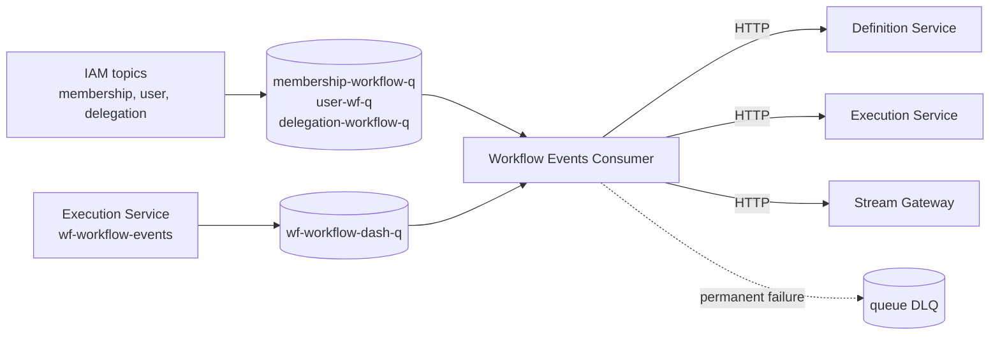

# Workflow Events Consumer — Low-Level Design

> **In-repo copy.** This file is this repo's own copy of this document, kept content-identical to the design repo's published copy. The two are intentionally allowed to differ only on embed-vs-link mechanics — never on content.

## Workflow Engine Platform — Inbound Event Bridge

| Field | Value |
| --- | --- |
| Document Type | Low-Level Design (LLD) |
| Service | Workflow Events Consumer (`workflow-events-consumer`, repository `workflow-event-consumer`) |
| Subsystem | Workflow Engine — inbound event delivery |
| Version | 1.0 |
| Date | 2026-10-12 |
| Status | Approved |
| Audience | Workflow Engine team, IAM, platform/infra |
| Owner database | None (stateless) |

### Revision history

| Version | Date | Notes |
| --- | --- | --- |
| 1.0 | 2026-10-12 | Initial LLD. Specifies the queue and event inventory across IAM and the Workflow Engine, the forwarding and failure semantics, the topology file, configuration, observability, deployment permissions and the test strategy, with the open items against IAM and the other Workflow documents in Appendix B. |

---

## Table of Contents

1. [Overview and Scope](#1-overview-and-scope)
2. [Architecture](#2-architecture)
3. [Event Inventory](#3-event-inventory)
4. [Forwarding and Failure Semantics](#4-forwarding-and-failure-semantics)
5. [Topology File](#5-topology-file)
6. [Configuration](#6-configuration)
7. [Observability](#7-observability)
8. [Deployment and Permissions](#8-deployment-and-permissions)
9. [Testing Strategy](#9-testing-strategy)
- [Appendix A: Design Decisions](#appendix-a-design-decisions)
- [Appendix B: Open Items](#appendix-b-open-items)

---

## 1. Overview and Scope

The Workflow Events Consumer receives SQS messages from the queues the Workflow Engine owns and forwards each message, unmodified, over HTTP to the Workflow services that act on it. The Definition Service, the Execution Service and the Stream Gateway each expose one internal events endpoint and hold no queue subscription of their own.

The consumer has no database and no inbox. Each target deduplicates redelivered events itself. It publishes no events and keeps no outbox.

The inventory covers the events IAM publishes that a Workflow service acts on and the Execution Service's lifecycle events that the Stream Gateway and the Execution Service consume. The Tender Service and the LLM subsystem join this consumer in later revisions: Tender's own events, and any LLM event that reaches Tender, add queues, targets and routes to the topology file without a change to the consumer.

---

## 2. Architecture

One consumer runs per queue declared in the topology file, each with its own concurrency, visibility timeout and per-message deadline. All consumers share one forwarder. A consumer that stops with an error stops the process, and the pod restarts.

Logs, metrics and traces go through `platform-gincommon`. Every queue receive, dead-letter send and envelope goes through `platform-events`.

---

## 3. Event Inventory

### 3.1 Queues

| Queue | Topic | Owner of the queue | Subscription filter |
| --- | --- | --- | --- |
| `membership-workflow-q` | `iam-membership-events` | Workflow | `TenderAssigneeOverridden`, `DepartmentMembershipGranted`, `DepartmentMembershipRevoked`, `DepartmentMembershipLevelChanged`, `TenantStateChanged` (IAM Organisation and Membership AsyncAPI) |
| `user-wf-q` | `iam-user-events` | Workflow | `UserAvailabilityChanged`, `UserDeleted` (IAM User Profile AsyncAPI) |
| `delegation-workflow-q` | `iam.delegation.events` | Workflow | `DelegationStarted`, `DelegationEnded`, `DelegationReviewRequested`, `DelegationEscalationRequested` (Appendix B, item 2) |
| `wf-workflow-dash-q` | `wf-workflow-events` | Workflow | The eleven types of §3.2 that the Stream Gateway renders (Stream Gateway LLD §3.2) |

Every queue has a dead-letter queue named `<queue>-dlq` and a redrive count of 5.

### 3.2 Event matrix

An event type absent from the topology's routes is sent to every target that accepts it; the Execution Service accepts only the types in §3.3. Every type below has an explicit route, so the fallback is a safety net for new types.

| Event type | Topic | Queue | Targets | Behaviour |
| --- | --- | --- | --- | --- |
| `TenantStateChanged` | `iam-membership-events` | `membership-workflow-q` | execution | The resolved tenant lifecycle relay. Execution pauses, resumes or terminates the tenant's instances. |
| `DepartmentMembershipRevoked` | `iam-membership-events` | `membership-workflow-q` | definition | A department membership removal. Definition invalidates templates the user is a default assignee on. |
| `MembershipRevoked` | `iam-membership-events` | `membership-workflow-q` | definition, execution | A user removed from a tenant. Definition invalidates their default assignments and Execution vacates their active assignments. Outside the queue's subscription filter (Appendix B, item 1). |
| `TenantMembershipsPurged` | `iam-membership-events` | `membership-workflow-q` | execution | The tenant offboarding cascade signal. Execution terminates the tenant's non-terminal instances. Outside the queue's subscription filter (Appendix B, item 1). |
| `TenderAssigneeOverridden` | `iam-membership-events` | `membership-workflow-q` | none (dropped) | A tender assignee override. Execution applies overrides through its node-override endpoint, so the event is dropped. |
| `DepartmentMembershipGranted` | `iam-membership-events` | `membership-workflow-q` | none (dropped) | A department membership grant. Eligibility is a live call, so the event is dropped. |
| `DepartmentMembershipLevelChanged` | `iam-membership-events` | `membership-workflow-q` | none (dropped) | A department level change. Eligibility is a live call, so the event is dropped. |
| `UserDeleted` | `iam-user-events` | `user-wf-q` | execution | A user deletion. Execution vacates the user's active assignments. |
| `UserAvailabilityChanged` | `iam-user-events` | `user-wf-q` | execution | An out-of-office change. Execution pauses or resumes the user's instances. |
| `DelegationStarted` | `iam.delegation.events` | `delegation-workflow-q` | execution | A delegation start. Execution reroutes the delegator's active assignments to the delegate. |
| `DelegationEnded` | `iam.delegation.events` | `delegation-workflow-q` | execution | A delegation end. Execution restores the assignments tagged with the delegation. |
| `DelegationReviewRequested` | `iam.delegation.events` | `delegation-workflow-q` | none (dropped) | A delegation review request. No Workflow service consumes it, so the event is dropped. |
| `DelegationEscalationRequested` | `iam.delegation.events` | `delegation-workflow-q` | none (dropped) | A delegation escalation request. No Workflow service consumes it, so the event is dropped. |
| `WorkflowTaskCreated` | `wf-workflow-events` | `wf-workflow-dash-q` | workflow-stream-gateway, execution | An Execution Service lifecycle event rendered by the Stream Gateway. Execution dispatches connector tasks from it. |
| `WorkflowTaskCompleted` | `wf-workflow-events` | `wf-workflow-dash-q` | workflow-stream-gateway | An Execution Service lifecycle event rendered by the Stream Gateway. |
| `WorkflowTaskDeferred` | `wf-workflow-events` | `wf-workflow-dash-q` | workflow-stream-gateway | An Execution Service lifecycle event rendered by the Stream Gateway. |
| `WorkflowTaskReassigned` | `wf-workflow-events` | `wf-workflow-dash-q` | workflow-stream-gateway | An Execution Service lifecycle event rendered by the Stream Gateway. |
| `WorkflowTaskSlaWarning` | `wf-workflow-events` | `wf-workflow-dash-q` | workflow-stream-gateway | An Execution Service lifecycle event rendered by the Stream Gateway. |
| `WorkflowTaskSlaBreached` | `wf-workflow-events` | `wf-workflow-dash-q` | workflow-stream-gateway | An Execution Service lifecycle event rendered by the Stream Gateway. |
| `WorkflowInstancePaused` | `wf-workflow-events` | `wf-workflow-dash-q` | workflow-stream-gateway | An Execution Service lifecycle event rendered by the Stream Gateway. |
| `WorkflowInstanceResumed` | `wf-workflow-events` | `wf-workflow-dash-q` | workflow-stream-gateway | An Execution Service lifecycle event rendered by the Stream Gateway. |
| `WorkflowInstanceCancelled` | `wf-workflow-events` | `wf-workflow-dash-q` | workflow-stream-gateway | An Execution Service lifecycle event rendered by the Stream Gateway. |
| `WorkflowInstanceTerminated` | `wf-workflow-events` | `wf-workflow-dash-q` | workflow-stream-gateway | An Execution Service lifecycle event rendered by the Stream Gateway. |
| `WorkflowInstanceFinished` | `wf-workflow-events` | `wf-workflow-dash-q` | workflow-stream-gateway | An Execution Service lifecycle event rendered by the Stream Gateway. |

### 3.3 Execution Service paths

The Execution Service receives each event on a path named for its category.

| Category | Event types |
| --- | --- |
| `delegation` | `DelegationStarted`, `DelegationEnded` |
| `user-profile` | `UserDeleted`, `UserAvailabilityChanged`, `MembershipRevoked` |
| `tenant` | `TenantStateChanged`, `TenantMembershipsPurged` |
| `workflow-task` | `WorkflowTaskCreated` |

The Definition Service and the Stream Gateway receive every event on the base events path. An event type outside the category table is not sent to the Execution Service.

### 3.4 Events that never reach this consumer

IAM publishes `TenantRoleGranted`, `TenantRoleRevoked`, `MFAReset`, `TenantSeatOverageStarted`, `TenantSeatOverageResolved`, `UserProvisioned`, `UserUpdated` and the tenant lifecycle events on other topics (`iam-tenant-events` and the billing topic) for the Audit, AuthZ, Notification, Realm, Billing and Delegation consumers. None is delivered to a Workflow queue.

The Execution Service publishes `WorkflowInstanceStarted`, `WorkflowInstanceDegraded`, `WorkflowInstanceFailed`, `WorkflowInstanceForceRouted`, `WorkflowTaskClaimed`, `WorkflowTaskSuperseded` and `WorkflowTaskFailed` to `wf-workflow-events` for the audit, notification, Tender and LLM consumers. The dashboard queue's filter excludes them.

---

## 4. Forwarding and Failure Semantics

1. **Original body.** The consumer forwards the message body exactly as received. A schema-encoded event reaches its target with the payload and `dataschema` intact, and the target decodes it. The consumer decodes nothing.
2. **Authentication.** Each request carries the target's own internal token and the trace context.
3. **Acknowledgement.** A message is deleted only after every target it was routed to answers 2xx.
4. **Permanent failures.** An answer of 400, 413 or 422 states that the request is malformed and cannot succeed later. When every failing target answers permanently, the consumer sends the original message to the queue's dead-letter queue with a reason naming the target and status, and deletes it from the source queue. If the dead-letter send fails, the message stays on the queue.
5. **Transient failures.** Every other failure, including 401, 403, 404, 408, 429, 5xx and network errors, leaves the message on the queue for redelivery with backoff. A permanent answer alongside a transient one is retried, because the transient target still needs the message.
6. **Receive threshold.** The consumer dead-letters a message on the fifth receive, one below the queues' redrive count, so the dead-letter reason is the consumer's own.
7. **Startup.** A queue without a redrive policy fails startup.

---

## 5. Topology File

One file declares the targets, the queues and the routes: a route maps an event type to a list of targets, and an empty list drops the type. Adding a queue, a target or a route is a configuration change. The file holds no secrets; each target names the environment variable that holds its token. The chart's values, the IAM policy and the AsyncAPI contract change together with the example file, and tests fail when they differ.

---

## 6. Configuration

| Variable | Purpose |
| --- | --- |
| `APP_ENV` | `local`, `dev`, `test`, `staging` or `prod`; outside `dev` and `local` every target's token variable must be set |
| `TOPOLOGY_CONFIG_PATH` | Path to the topology file |
| `AWS_REGION`, `AWS_ENDPOINT_URL` | Region and emulator override |
| `CONSUMER_CONCURRENCY` | Concurrent handlers per queue |
| `VISIBILITY_TIMEOUT`, `DRAIN_TIMEOUT` | Visibility timeout and shutdown grace per consumer |
| `FORWARD_TIMEOUT`, `HANDLER_TIMEOUT` | Per-target request timeout and per-message deadline; the forward timeout does not exceed the handler timeout, which does not exceed the visibility timeout |
| `RETRY_BACKOFF_BASE`, `RETRY_BACKOFF_MAX` | Redelivery backoff |
| `QUEUE_DEPTH_INTERVAL` | Cadence of the queue-depth metric |
| `HEALTH_PORT` | Health and metrics port |

A malformed number or duration fails startup.

---

## 7. Observability

Service metrics are `workflow_events_consumer_*`: forward attempts by queue, target and result (`ok`, `error`, `skipped`), forward duration and handler duration. The consume, dead-letter and queue-depth series are `platform_*` from `platform-events`, and a dead-letter the consumer sends is counted there once. `tenant_id` is never a label. Alerts cover failing messages, dead-lettered messages and handler panics. The metric registry is generated from a real scrape and checked in CI.

---

## 8. Deployment and Permissions

The service runs under a service account whose role grants, per queue, receive, delete, visibility change and attribute read, and per dead-letter queue, get-queue-URL, send and attribute read. A dead-letter queue encrypted with a customer-managed key additionally needs the key's generate-data-key and decrypt actions. The role grants no publish, storage or registry action.

The chart carries the topology, a pod disruption budget, an autoscaler, a network policy and a service monitor. Health probes use a static endpoint; the metrics endpoint serves the same port.

---

## 9. Testing Strategy

Unit tests cover routing, failure classification, the handler's dead-letter decision and configuration validation. Integration tests run against an SQS and SNS emulator and cover routing, redelivery on transient failure, dead-lettering after one delivery on a permanent failure, and a schema-encoded event forwarded unchanged. Drift tests tie the chart, the IAM policy, the AsyncAPI contract and the runbook's tables to the topology example. An import-direction check enforces the package layering. The coverage gate is 90 percent.

---

## Appendix A: Design Decisions

| # | Decision | Reason |
| --- | --- | --- |
| 1 | The consumer is the only queue subscriber for the Workflow services | One place owns queue permissions, backoff, the per-message deadline and the consume metrics |
| 2 | The original message body is forwarded | A re-serialised envelope drops unknown fields and breaks schema-encoded payloads |
| 3 | Routes are data in one topology file | A new queue, target or route needs no code change |
| 4 | An empty target list drops an event type | It records that the type is known and deliberately not consumed |
| 5 | Only 400, 413 and 422 are permanent | Those statuses state that the request is malformed; 401, 403 and 404 describe a token or a deployment that a later attempt can fix |
| 6 | A permanent failure is dead-lettered after one delivery | Retrying an identical request cannot succeed and delays the operator's view |
| 7 | The receive threshold is one below the queues' redrive count | The consumer's dead-letter carries the reason; SQS redrive is the backstop |
| 8 | The Execution Service receives only categorised types | It registers one route per category and has no base route |
| 9 | Each target deduplicates for itself | The consumer keeps no state |

---

## Appendix B: Open Items

| # | Item | Owner |
| --- | --- | --- |
| 1 | `MembershipRevoked` and `TenantMembershipsPurged` are outside `membership-workflow-q`'s subscription filter in IAM Organisation and Membership's AsyncAPI. The Definition and Execution services act on both, so the queue's filter needs both types. | IAM Organisation and Membership |
| 2 | `delegation-workflow-q` and its subscription to `iam.delegation.events`, filtered to the delegation types, are to be provisioned. The Execution Service LLD §6.2 places `DelegationStarted` and `DelegationEnded` on `iam.membership.events`; the producer publishes them to `iam.delegation.events`. | Workflow infrastructure, IAM Delegation |
| 3 | The dead-letter queue name `wf-workflow-dash-q-dlq` follows the `<queue>-dlq` convention and is unconfirmed. The dashboard queue's filter policy is infrastructure provisioning (Stream Gateway LLD Appendix B). | Workflow infrastructure |
| 4 | The Workflow HLD §9.1 and the Execution Service LLD §6.2 state that no subscription filter policy exists. IAM's AsyncAPI files define one per queue. The Execution Service AsyncAPI lists `MembershipRevoked` under the user topic; the producer publishes it on the membership topic. | Workflow documents |
| 5 | The network policy permits egress on port 443 only while the example target addresses are plain HTTP. Readiness ignores receive failures that the library only logs. A downstream outage longer than about two minutes dead-letters the messages that arrived during it. | Workflow infrastructure |
| 6 | The Tender Service and the LLM subsystem join the consumer in later revisions, with the Tender and notification topics named in the Stream Gateway LLD §1. | Tender, LLM |
| 7 | The `platform-events` maintainers are asked to confirm the handler-side dead-letter pattern and its metric and permission semantics. | platform-events |
