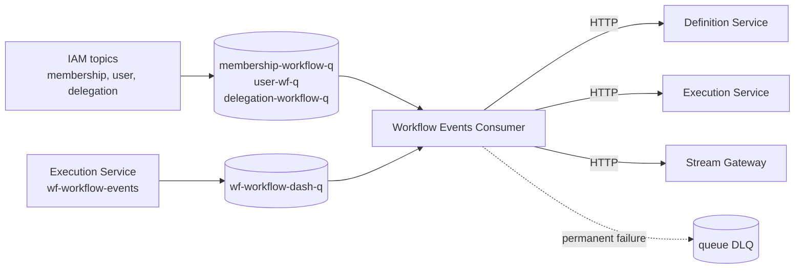

# Workflow Events Consumer — Low-Level Design

> **In-repo copy.** This file is this repo's own copy of this document, kept content-identical to the design repo's published copy. The two are intentionally allowed to differ only on embed-vs-link mechanics — never on content.

## Workflow Engine Platform — Inbound Event Bridge

| Field | Value |
| --- | --- |
| Document Type | Low-Level Design (LLD) |
| Service | Workflow Events Consumer (`workflow-events-consumer`, repository `workflow-event-consumer`) |
| Subsystem | Workflow Engine — inbound event delivery |
| Version | 1.5 |
| Date | 2026-10-19 |
| Status | Approved |
| Audience | Workflow Engine team, IAM, platform/infra |
| Owner database | None (stateless) |

### Revision history

| Version | Date | Notes |
| --- | --- | --- |
| 1.0 | 2026-10-12 | Initial LLD. Specifies the queue and event inventory across IAM and the Workflow Engine, the forwarding and failure semantics, the topology file, configuration, observability, deployment permissions and the test strategy, with the open items against IAM and the other Workflow documents in Appendix B. |
| 1.1 | 2026-10-12 | Production-readiness review. The health endpoint fails after two minutes without a successful receive (§4 item 8); `APP_ENV` and `AWS_REGION` are required (§6); target addresses are https outside `dev` and `local` and redirects are not followed (§4 item 2); the default backoff base is 30 seconds and the retry window about seven minutes (§4 item 6, §6); the handler metric labels dead-lettered and dropped messages (§7); the chart sets the termination grace period, enables the ServiceMonitor and selects alerts by job suffix (§8); the image build leaves no credential in a layer or cache (§8); malformed message bodies stay out of the logs (§7). Appendix A decisions 10 to 14 and Appendix B are updated, and Appendix B item 4 is resolved by the corrections to the Workflow HLD §9.1, the Execution LLD rev 1.76 and the Execution AsyncAPI. |
| 1.2 | 2026-10-13 | Contract tests against the targets' specs (§9, register item 9). Every event type routed to the Definition Service or the Execution Service is forwarded through the real forwarder and checked against that service's internal OpenAPI copy in `api/contracts/`, with its source recorded in `SOURCES` and checked by `make contract-check`; every declared status must be classified as permanent or retried. |
| 1.3 | 2026-10-14 | **In-cluster targets over HTTP, liveness apart from readiness, and the answers the consumer reads** (§4 items 2, 5 and 8, register item 12). A target address is https, or http naming a port, outside `dev` and `local`; the chart points at the services' plain HTTP port 8080 and the NetworkPolicy opens it. `/healthz` is liveness and `/readyz` follows the receive watch. A `502 EVENT_DECODE_FAILED` from a target is a transient failure like any 5xx: retried, then dead-lettered by the receive count. The SNS subscriptions into the queues must use raw message delivery, as `platform-events` requires. The forward client drains a bounded part of each answer so connections are reused. |
| 1.4 | 2026-10-18 | **The tenant offboarding events also reach the Definition Service** (§3, §5). `TenantStateChanged` and `TenantMembershipsPurged` were routed to Execution alone, so a departed tenant's templates and credentials stayed. Both are routed to the Definition Service as well, which records the tenant for a purge after a retention period (Definition LLD §7.4.4, §7.4.6); the category path rule stays Execution-only, so Definition receives them on its single events path. |
| 1.5 | 2026-10-19 | **The receive threshold and the stall window are settings, and the retry span is stated as it is** (§4 items 6 and 8). The threshold was a constant and the stall window a constant, so a different downstream outage budget needed a code change; they are `MAX_RECEIVE_COUNT` (default 4) and `RECEIVE_STALL_WINDOW` (default two minutes), defaults unchanged. The text said the retries spread over about seven minutes and covered a rolling deploy; with the library dead-lettering a message whose receive count exceeds the threshold, a message is handled four times, the last at 210 seconds, and dead-lettered on the fifth receive at 450 seconds, so the outage survived is about three and a half minutes (seven and a half with a threshold of 5, which needs the queues' redrive count raised first). |
| 1.6 | 2026-10-22 | **IAM's queue filters are settled** (§2, §3.2, Appendix B). Organisation and Membership adds `MembershipRevoked` and `TenantMembershipsPurged` to `membership-workflow-q`'s filter (its LLD rev 2.34), and the Delegation Service approved `delegation-workflow-q` filtered to `DelegationStarted` and `DelegationEnded` (its LLD rev 2.23). The delegation review and escalation requests no longer reach the queue, so their routes are removed. |

---

## Table of Contents

1. [Overview and Scope](#1-overview-and-scope)
2. [Architecture](#2-architecture)
3. [Event Inventory](#3-event-inventory)
4. [Forwarding and Failure Semantics](#4-forwarding-and-failure-semantics)
5. [Topology File](#5-topology-file)
6. [Configuration](#6-configuration)
7. [Observability](#7-observability)
8. [Deployment and Permissions](#8-deployment-and-permissions)
9. [Testing Strategy](#9-testing-strategy)
- [Appendix A: Design Decisions](#appendix-a-design-decisions)
- [Appendix B: Open Items](#appendix-b-open-items)

---

## 1. Overview and Scope

The Workflow Events Consumer receives SQS messages from the queues the Workflow Engine owns and forwards each message, unmodified, over HTTP to the Workflow services that act on it. The Definition Service, the Execution Service and the Stream Gateway each expose one internal events endpoint and hold no queue subscription of their own.

The consumer has no database and no inbox. Each target deduplicates redelivered events itself. It publishes no events and keeps no outbox.

The inventory covers the events IAM publishes that a Workflow service acts on and the Execution Service's lifecycle events that the Stream Gateway and the Execution Service consume. The Tender Service and the LLM subsystem join this consumer in later revisions: Tender's own events, and any LLM event that reaches Tender, add queues, targets and routes to the topology file without a change to the consumer.

---

## 2. Architecture

One consumer runs per queue declared in the topology file, each with its own concurrency, visibility timeout and per-message deadline. All consumers share one forwarder. A consumer that stops with an error, a consumer that returns without being stopped, and a health server that cannot bind stop the process, and the pod restarts.

Logs, metrics and traces go through `platform-gincommon`. Every queue receive, dead-letter send and envelope goes through `platform-events`.

---

## 3. Event Inventory

### 3.1 Queues

| Queue | Topic | Owner of the queue | Subscription filter |
| --- | --- | --- | --- |
| `membership-workflow-q` | `iam-membership-events` | Workflow | `TenderAssigneeOverridden`, `DepartmentMembershipGranted`, `DepartmentMembershipRevoked`, `DepartmentMembershipLevelChanged`, `TenantStateChanged`, `MembershipRevoked`, `TenantMembershipsPurged` (IAM Organisation and Membership AsyncAPI) |
| `user-wf-q` | `iam-user-events` | Workflow | `UserAvailabilityChanged`, `UserDeleted` (IAM User Profile AsyncAPI) |
| `delegation-workflow-q` | `iam.delegation.events` | Workflow | `DelegationStarted`, `DelegationEnded` (IAM Delegation LLD rev 2.23: the subscription filter, with raw message delivery) |
| `wf-workflow-dash-q` | `wf-workflow-events` | Workflow | The eleven types of §3.2 that the Stream Gateway renders (Stream Gateway LLD §3.2) |

Every queue has a dead-letter queue named `<queue>-dlq` and a redrive count of 5.

### 3.2 Event matrix

An event type absent from the topology's routes is sent to every target that accepts it; the Execution Service accepts only the types in §3.3. Every type below has an explicit route, so the fallback is a safety net for new types.

| Event type | Topic | Queue | Targets | Behaviour |
| --- | --- | --- | --- | --- |
| `TenantStateChanged` | `iam-membership-events` | `membership-workflow-q` | execution, definition | The resolved tenant lifecycle relay. Execution pauses, resumes or terminates the tenant's instances; for a status of offboarded Definition records the tenant for the purge of its templates and credentials, and ignores every other status. |
| `DepartmentMembershipRevoked` | `iam-membership-events` | `membership-workflow-q` | definition | A department membership removal. Definition invalidates templates the user is a default assignee on. |
| `MembershipRevoked` | `iam-membership-events` | `membership-workflow-q` | definition, execution | A user removed from a tenant. Definition invalidates their default assignments and Execution vacates their active assignments. Outside the queue's subscription filter (Appendix B, item 1). |
| `TenantMembershipsPurged` | `iam-membership-events` | `membership-workflow-q` | execution, definition | The tenant offboarding cascade signal. Execution terminates the tenant's non-terminal instances and Definition records the tenant for the purge of its templates and credentials. Outside the queue's subscription filter (Appendix B, item 1). |
| `TenderAssigneeOverridden` | `iam-membership-events` | `membership-workflow-q` | none (dropped) | A tender assignee override. Execution applies overrides through its node-override endpoint, so the event is dropped. |
| `DepartmentMembershipGranted` | `iam-membership-events` | `membership-workflow-q` | none (dropped) | A department membership grant. Eligibility is a live call, so the event is dropped. |
| `DepartmentMembershipLevelChanged` | `iam-membership-events` | `membership-workflow-q` | none (dropped) | A department level change. Eligibility is a live call, so the event is dropped. |
| `UserDeleted` | `iam-user-events` | `user-wf-q` | execution | A user deletion. Execution vacates the user's active assignments. |
| `UserAvailabilityChanged` | `iam-user-events` | `user-wf-q` | execution | An out-of-office change. Execution pauses or resumes the user's instances. |
| `DelegationStarted` | `iam.delegation.events` | `delegation-workflow-q` | execution | A delegation start. Execution reroutes the delegator's active assignments to the delegate. |
| `DelegationEnded` | `iam.delegation.events` | `delegation-workflow-q` | execution | A delegation end. Execution restores the assignments tagged with the delegation. |
| `WorkflowTaskCreated` | `wf-workflow-events` | `wf-workflow-dash-q` | workflow-stream-gateway, execution | An Execution Service lifecycle event rendered by the Stream Gateway. Execution dispatches connector tasks from it. |
| `WorkflowTaskCompleted` | `wf-workflow-events` | `wf-workflow-dash-q` | workflow-stream-gateway | An Execution Service lifecycle event rendered by the Stream Gateway. |
| `WorkflowTaskDeferred` | `wf-workflow-events` | `wf-workflow-dash-q` | workflow-stream-gateway | An Execution Service lifecycle event rendered by the Stream Gateway. |
| `WorkflowTaskReassigned` | `wf-workflow-events` | `wf-workflow-dash-q` | workflow-stream-gateway | An Execution Service lifecycle event rendered by the Stream Gateway. |
| `WorkflowTaskSlaWarning` | `wf-workflow-events` | `wf-workflow-dash-q` | workflow-stream-gateway | An Execution Service lifecycle event rendered by the Stream Gateway. |
| `WorkflowTaskSlaBreached` | `wf-workflow-events` | `wf-workflow-dash-q` | workflow-stream-gateway | An Execution Service lifecycle event rendered by the Stream Gateway. |
| `WorkflowInstancePaused` | `wf-workflow-events` | `wf-workflow-dash-q` | workflow-stream-gateway | An Execution Service lifecycle event rendered by the Stream Gateway. |
| `WorkflowInstanceResumed` | `wf-workflow-events` | `wf-workflow-dash-q` | workflow-stream-gateway | An Execution Service lifecycle event rendered by the Stream Gateway. |
| `WorkflowInstanceCancelled` | `wf-workflow-events` | `wf-workflow-dash-q` | workflow-stream-gateway | An Execution Service lifecycle event rendered by the Stream Gateway. |
| `WorkflowInstanceTerminated` | `wf-workflow-events` | `wf-workflow-dash-q` | workflow-stream-gateway | An Execution Service lifecycle event rendered by the Stream Gateway. |
| `WorkflowInstanceFinished` | `wf-workflow-events` | `wf-workflow-dash-q` | workflow-stream-gateway | An Execution Service lifecycle event rendered by the Stream Gateway. |

### 3.3 Execution Service paths

The Execution Service receives each event on a path named for its category.

| Category | Event types |
| --- | --- |
| `delegation` | `DelegationStarted`, `DelegationEnded` |
| `user-profile` | `UserDeleted`, `UserAvailabilityChanged`, `MembershipRevoked` |
| `tenant` | `TenantStateChanged`, `TenantMembershipsPurged` |
| `workflow-task` | `WorkflowTaskCreated` |

The Definition Service and the Stream Gateway receive every event on the base events path. An event type outside the category table is not sent to the Execution Service.

### 3.4 Events that never reach this consumer

IAM publishes `TenantRoleGranted`, `TenantRoleRevoked`, `MFAReset`, `TenantSeatOverageStarted`, `TenantSeatOverageResolved`, `UserProvisioned`, `UserUpdated` and the tenant lifecycle events on other topics (`iam-tenant-events` and the billing topic) for the Audit, AuthZ, Notification, Realm, Billing and Delegation consumers. None is delivered to a Workflow queue.

The Execution Service publishes `WorkflowInstanceStarted`, `WorkflowInstanceDegraded`, `WorkflowInstanceFailed`, `WorkflowInstanceForceRouted`, `WorkflowTaskClaimed`, `WorkflowTaskSuperseded` and `WorkflowTaskFailed` to `wf-workflow-events` for the audit, notification, Tender and LLM consumers. The dashboard queue's filter excludes them.

---

## 4. Forwarding and Failure Semantics

1. **Original body.** The consumer forwards the message body exactly as received. A schema-encoded event reaches its target with the payload and `dataschema` intact, and the target decodes it. The consumer decodes nothing.
2. **Authentication.** Each request carries the target's own internal token and the trace context. Outside `dev` and `local` every target address is https, or http naming a port, and every token is set, and the client follows no redirect, so the token reaches only the configured host.
3. **Acknowledgement.** A message is deleted only after every target it was routed to answers 2xx.
4. **Permanent failures.** An answer of 400, 413 or 422 states that the request is malformed and cannot succeed later. When every failing target answers permanently, the consumer sends the original message to the queue's dead-letter queue with a reason naming the target and status, and deletes it from the source queue. If the dead-letter send fails, the message stays on the queue.
5. **Transient failures.** Every other failure, including 401, 403, 404, 408, 429, 5xx and network errors, leaves the message on the queue for redelivery with backoff. A `502` with the code `EVENT_DECODE_FAILED`, answered when an envelope's registry-framed payload cannot be decoded, is one of these. A permanent answer alongside a transient one is retried, because the transient target still needs the message. The SNS subscriptions into the queues use raw message delivery, as `platform-events` requires; without it the body is an SNS wrapper that no target can read.
6. **Receive threshold.** The consumer handles a message on its first four receives and dead-letters it on the fifth, one below the queues' redrive count of five, so the dead-letter reason is the consumer's own; a message past the threshold is forwarded without another handling attempt. With the default backoff base of 30 seconds a message is handled at 0, 30 seconds, 90 seconds and 210 seconds and dead-lettered at 450 seconds, so a target outage of about three and a half minutes is survived, which covers a rolling deploy of a target, and a longer one dead-letters what arrived during it and needs a redrive from the dead-letter queue. `MAX_RECEIVE_COUNT` (default 4, at least 1) sets the threshold: raising it to 5 extends the survived outage to about seven and a half minutes, and the redrive count of every queue, which infrastructure owns, must be raised above it first, or SQS moves the message before the consumer dead-letters it. Each queue's redrive count stays above the threshold, and an alert fires when any dead-letter queue is not empty, which also covers SQS moving a message itself.
7. **Startup.** A queue without a redrive policy fails startup, as does an unset `APP_ENV` or `AWS_REGION`.
8. **Receive health.** The health endpoint answers 503 until the first receive has succeeded and again when no receive has succeeded for `RECEIVE_STALL_WINDOW` (default two minutes), so a bad rollout never replaces a healthy pod and a consumer that cannot receive, for a denied permission, a wrong queue or a wrong region, stops being ready and is restarted.

---

## 5. Topology File

One file declares the targets, the queues and the routes: a route maps an event type to a list of targets, and an empty list drops the type. Adding a queue, a target or a route is a configuration change. The file holds no secrets; each target names the environment variable that holds its token. The chart's values, the IAM policy and the AsyncAPI contract change together with the example file, and tests fail when they differ.

---

## 6. Configuration

| Variable | Purpose |
| --- | --- |
| `APP_ENV` | Required: `local`, `dev`, `test`, `staging` or `prod`; outside `dev` and `local` every target's token variable must be set |
| `TOPOLOGY_CONFIG_PATH` | Path to the topology file |
| `AWS_REGION`, `AWS_ENDPOINT_URL` | Region (required) and emulator override |
| `CONSUMER_CONCURRENCY` | Concurrent handlers per queue |
| `VISIBILITY_TIMEOUT`, `DRAIN_TIMEOUT` | Visibility timeout and shutdown grace per consumer |
| `FORWARD_TIMEOUT`, `HANDLER_TIMEOUT` | Per-target request timeout and per-message deadline; the forward timeout does not exceed the handler timeout, which does not exceed the visibility timeout |
| `RETRY_BACKOFF_BASE`, `RETRY_BACKOFF_MAX` | Redelivery backoff, defaults 30 seconds and 5 minutes |
| `MAX_RECEIVE_COUNT` | Receive count above which a message is dead-lettered instead of handled (default `4`, at least 1): four handling attempts, the fifth receive dead-letters. It must stay below every queue's redrive count (infrastructure-owned), or SQS moves the message first |
| `RECEIVE_STALL_WINDOW` | How long without a successful receive before `/readyz` answers 503 (default `2m`) |
| `QUEUE_DEPTH_INTERVAL` | Cadence of the queue-depth metric |
| `HEALTH_PORT` | Health and metrics port |

A malformed number or duration fails startup.

---

## 7. Observability

Service metrics are `workflow_events_consumer_*`: forward attempts by queue, target and result (`ok`, `error`, `skipped`), forward duration, and handler duration by result (`ok`, `error`, `dead_lettered`, `dropped`). The consume, dead-letter and queue-depth series are `platform_*` from `platform-events`, and a dead-letter the consumer sends is counted there once. `tenant_id` is never a label. Message bodies are never logged; a malformed body is recorded by size and SHA-256 and kept in the dead-letter queue. Alerts cover failing messages, dead-lettered messages, a non-empty dead-letter queue, a failing receive, a queue backlog and handler panics. The metric registry is generated from a real scrape and checked in CI.

---

## 8. Deployment and Permissions

The service runs under a service account whose role grants, per queue, receive, delete, visibility change and attribute read, and per dead-letter queue, get-queue-URL, send and attribute read. A dead-letter queue encrypted with a customer-managed key additionally needs the key's generate-data-key and decrypt actions. The role grants no publish, storage or registry action.

The chart carries the topology, a pod disruption budget, an autoscaler, a network policy and a service monitor that is on by default; the alerts select the job by suffix because the service monitor prefixes it with the release name. The termination grace period exceeds the drain timeout plus the handler deadline. Liveness and readiness use the health endpoint of §4 item 8, and the metrics endpoint serves the same port. The image build never leaves the private-module credential in a layer, and the release build neither reads nor exports a registry cache.

---

## 9. Testing Strategy

Unit tests cover routing, failure classification, the handler's dead-letter decision and configuration validation. Integration tests run against an SQS and SNS emulator and cover routing, redelivery on transient failure, dead-lettering after one delivery on a permanent failure, and a schema-encoded event forwarded unchanged. Drift tests tie the chart, the IAM policy, the AsyncAPI contract and the runbook's tables to the topology example. Contract tests forward every event type the topology routes to the Definition Service or the Execution Service through the real forwarder and hold each request to that service's internal OpenAPI document (copied under `api/contracts/` and checked against its source by `make contract-check`), and require that every status either document declares for the route is classified: `400`, `413` and `422` dead-letter after one delivery and every other failure is retried. Integration tests also confirm that a malformed body never reaches the logs. Chart tests cover the termination grace period, the service monitor and the alert selectors. An import-direction check enforces the package layering. The coverage gate is 90 percent.

---

## Appendix A: Design Decisions

| # | Decision | Reason |
| --- | --- | --- |
| 1 | The consumer is the only queue subscriber for the Workflow services | One place owns queue permissions, backoff, the per-message deadline and the consume metrics |
| 2 | The original message body is forwarded | A re-serialised envelope drops unknown fields and breaks schema-encoded payloads |
| 3 | Routes are data in one topology file | A new queue, target or route needs no code change |
| 4 | An empty target list drops an event type | It records that the type is known and deliberately not consumed |
| 5 | Only 400, 413 and 422 are permanent | Those statuses state that the request is malformed; 401, 403 and 404 describe a token or a deployment that a later attempt can fix |
| 6 | A permanent failure is dead-lettered after one delivery | Retrying an identical request cannot succeed and delays the operator's view |
| 7 | The receive threshold is one below the queues' redrive count | The consumer's dead-letter carries the reason; SQS redrive is the backstop |
| 8 | The Execution Service receives only categorised types | It registers one route per category and has no base route |
| 9 | Each target deduplicates for itself | The consumer keeps no state |
| 10 | Readiness depends on successful receives | The library retries a failing receive forever, so only the health endpoint can take a pod that consumes nothing out of service |
| 11 | `APP_ENV` and `AWS_REGION` have no default | A default environment of `dev` accepted empty tokens in production, and a default region signed requests for the wrong queues |
| 12 | Target addresses are https, or http naming a port, outside `dev` and `local`, and redirects are not followed | The in-cluster services serve plain HTTP on 8080, so the token travels in the cluster under the NetworkPolicies and never to another host |
| 13 | The retry window covers a rolling deploy of a target | A shorter window dead-letters every event that arrives while a target restarts |
| 14 | The build credential lives only inside the `RUN` that uses it | A credential in a layer or in an exported cache is readable by anyone who can pull the image or the cache |

---

## Appendix B: Open Items

| # | Item | Owner |
| --- | --- | --- |
| ~~1~~ | ~~`MembershipRevoked` and `TenantMembershipsPurged` are outside `membership-workflow-q`'s subscription filter in IAM Organisation and Membership's AsyncAPI.~~ RESOLVED (rev 1.6): Organisation and Membership LLD rev 2.34 adds both to the filter. The production subscription filter is infrastructure provisioning. | IAM Organisation and Membership |
| 2 | `delegation-workflow-q` and its dead-letter queue (redrive count 5) are to be provisioned, with the subscription to `iam.delegation.events` that the Delegation Service approved in its LLD rev 2.23: raw message delivery, filtered to `DelegationStarted` and `DelegationEnded`, and a queue policy allowing `sqs:SendMessage` from the topic. | Workflow infrastructure |
| 3 | The dead-letter queue name `wf-workflow-dash-q-dlq` follows the `<queue>-dlq` convention and is unconfirmed. The dashboard queue's filter policy is infrastructure provisioning (Stream Gateway LLD Appendix B). | Workflow infrastructure |
| 4 | ~~The Workflow HLD §9.1 and the Execution Service LLD §6.2 state that no subscription filter policy exists, and the Execution Service AsyncAPI lists `MembershipRevoked` under the user topic.~~ RESOLVED (rev 1.1 — the HLD §9.1, the Execution LLD rev 1.76 and the Execution AsyncAPI follow IAM's per-queue filters, the delegation topic and the membership topic). | Workflow documents |
| 5 | Pod autoscaling is CPU and memory based and off by default; scaling on queue depth is an infrastructure option. No admission policy enforces the Cosign signature and the chart deploys by tag. | Workflow infrastructure |
| 6 | The Tender Service and the LLM subsystem join the consumer in later revisions, with the Tender and notification topics named in the Stream Gateway LLD §1. | Tender, LLM |
| 7 | The `platform-events` maintainers are asked to confirm the handler-side dead-letter pattern and its metric and permission semantics. | platform-events |
| 8 | GitHub Actions are pinned by tag in every Workflow service; pinning by commit SHA is one change across the services. | Workflow engineering |
| ~~9~~ | ~~The category paths of §3.3 are tested against the Execution Service's router in its own repository; this repository has no cross-repository contract test.~~ Closed 2026-10-13: the contract tests of §9 hold the forwarded paths and the declared statuses to both services' specs. | Workflow engineering |
